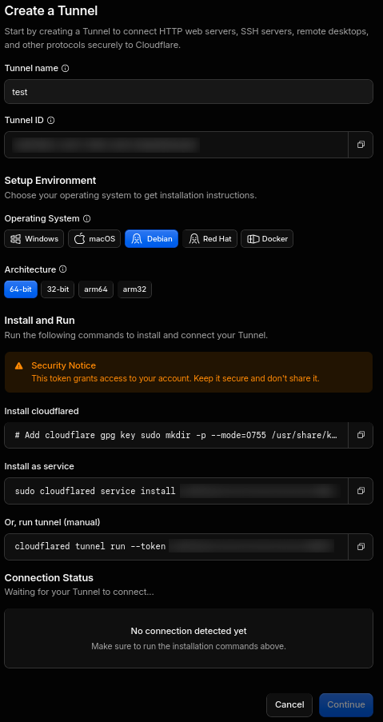
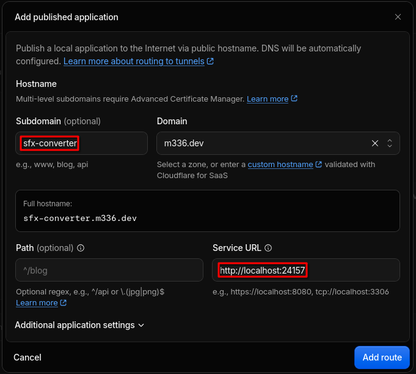
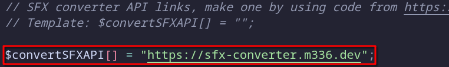
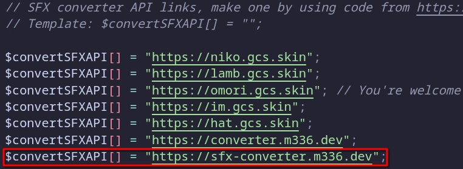

:::note
Ce guide est principalement destiné aux propriétaires/administrateurs de GDPS. Si vous n'êtes qu'un joueur et que la conversion de SFXs est lente, vous pouvez demander au propriétaire du GDPS sur lequel vous jouez de suivre ce guide :)
:::

:::caution
Ce guide n'est utile que si vous autorisez vos joueurs à mettre en ligne leurs propres SFXs par fichier(s).
:::

Ce guide vous montrera comment auto-héberger un convertisseur de SFX pour votre GDPS en utilisant soit la [version originale de MegaSa1nt en JavaScript](#mettre-en-place-le-convertisseur-de-megasa1nt), soit le [rewrite de M336 en C#](#mettre-en-place-le-convertisseur-de-m336) !

## Prérequis
Pour suivre ce guide, vous aurez besoin de :
- Un GDPS qui utilise la [fork GMDprivateServer de MegaSa1nt](https://github.com/MegaSa1nt/GMDprivateServer/tree/master)
- Une machine capable de tourner 24h/7
- Un nom de domaine géré avec [Cloudflare](https://www.cloudflare.com/)
- Une connexion internet stable

## Mettre en place le convertisseur
:::tip
Sur Linux, pour permettre à votre application de continuer à tourner même après avoir fermé votre session SSH, vous pouvez utiliser des outils tels que [PM2](https://pm2.keymetrics.io/docs/faq/) ou [Screen](https://www.geeksforgeeks.org/linux-unix/screen-command-in-linux-with-examples/) !
:::

### Mettre en place le convertisseur de MegaSa1nt
1. Téléchargez [Node.js](https://nodejs.org/en/download), préférablement une version LTS récente.
2. [Téléchargez le repository](https://github.com/MegaSa1nt/GDPS-ConvertSFX/archive/refs/heads/main.zip) sur une machine qui peut tourner 24/7 ou clonez-le avec : `git clone https://github.com/MegaSa1nt/GDPS-ConvertSFX.git`.
3. Ensuite, dans son dossier (décompressé), installez les dépendances avec `npm install` et soyez libre de configurer [`config.json`](https://github.com/MegaSa1nt/GDPS-ConvertSFX/blob/main/config.json) selon vos besoins.
4. Enfin, démarrez le convertisseur en exécutant `node .` depuis le dossier du repository !

### Mettre en place le convertisseur de M336
1. Téléchargez le binaire précompilé approprié pour votre système depuis la [version la plus récente](https://github.com/M336G/SFXConverter/releases/latest).
2. Ensuite, dans son dossier (décompressé), soyez libre de remplir le fichier `.env` selon vos besoins (regardez [.env.example](https://github.com/M336G/SFXConverter/blob/main/.env.example) pour avoir un exemple).
3. Enfin, démarrez le convertisseur en exécutant le binaire depuis le dossier extrait (sur Linux, vous aurez peut-être besoin de le rendre exécutable avec `chmod +x <nom_du_binaire>`).

## Rendre votre convertisseur accessible sur Internet avec Cloudflare Tunnel
:::note
Il y a plein d'autres moyens de rendre votre convertisseur publiquement accessible. Ce guide utilise Cloudflare Tunnel, car c'est l'une des solutions les plus pratiques.

Soyez libre d'utiliser une autre méthode si vous êtes familier avec celle-ci !
:::

:::caution
Veuillez noter que Cloudflare Tunnel a une limite d'envoi de 100 Mo.
:::

Pour permettre à vos membres d'utiliser votre convertisseur sur le tableau de bord de votre GDPS, vous aurez d'abord besoin de le rendre accessible sur Internet.

1. Ouvrez le [tableau de bord Cloudflare](https://dash.cloudflare.com/), naviguez vers **Réseaux > Tunnels**, et cliquez sur **Créer un Tunnel**.
2. Donnez un nom à votre tunnel, puis suivez les instructions sur comment installer `cloudflared` en tant que service sur votre serveur.

3. Quand le tunnel est prêt, ouvrez-le, naviguez vers **Routes**, cliquez sur **Ajouter une route**, et sélectionnez **Application publiée**. Configurez la route pour pointer vers l'URL que vous voulez pour votre convertisseur. Ensuite, si vous n'avez pas changé le port de votre convertisseur, renseignez `http://localhost:24157` pour l'URL du service.

4. C'est tout ! Votre convertisseur est désormais publiquement accessible sur Internet.

## Utiliser votre convertisseur sur votre GDPS
Maintenant, ouvrez [`config/dashboard.php`](https://github.com/MegaSa1nt/GMDprivateServer/blob/67ede474cbfde8c932ede53198b743e1ffb3f3b7/config/dashboard.php#L59-L64) dans l'installation de votre GDPS.

Ici, vous pouvez choisir de :
- **N'utiliser que votre propre convertisseur** en enlevant tous les autres convertisseurs du fichier de configuration.

- **Garder les convertisseurs déjà existants et rajouter le vôtre** pour tous les utiliser.

-----

*Dernièrement mis à jour : 24 Octobre 2026*